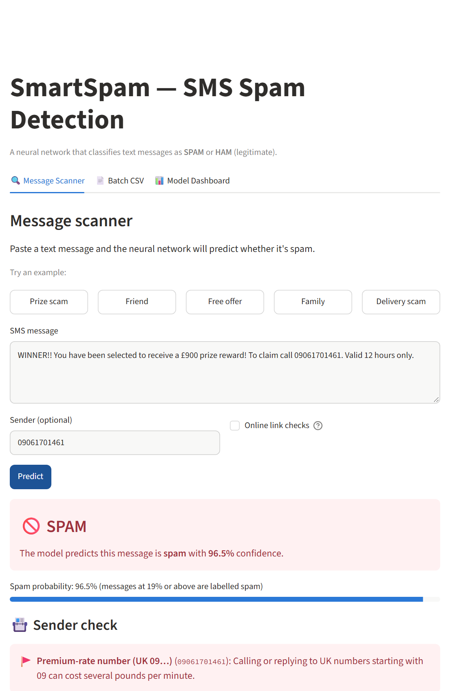
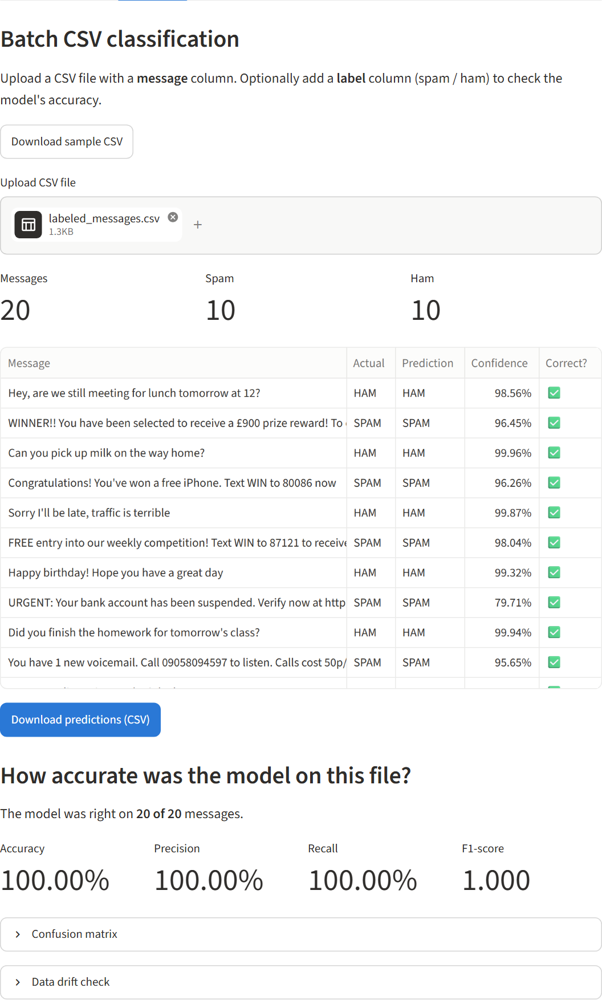
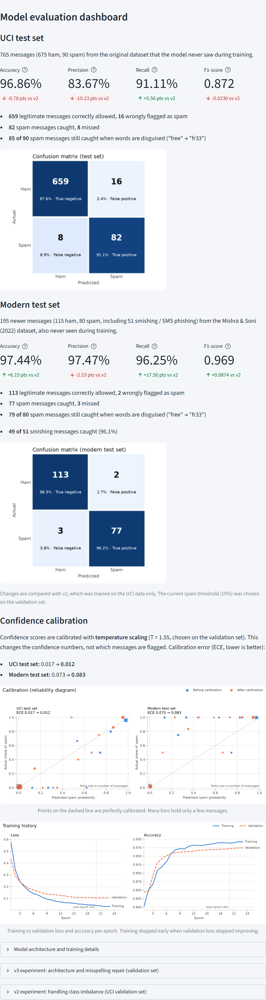
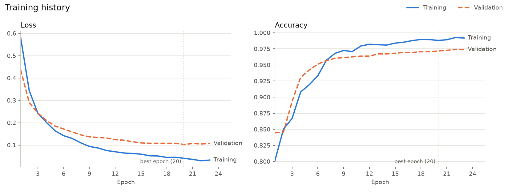
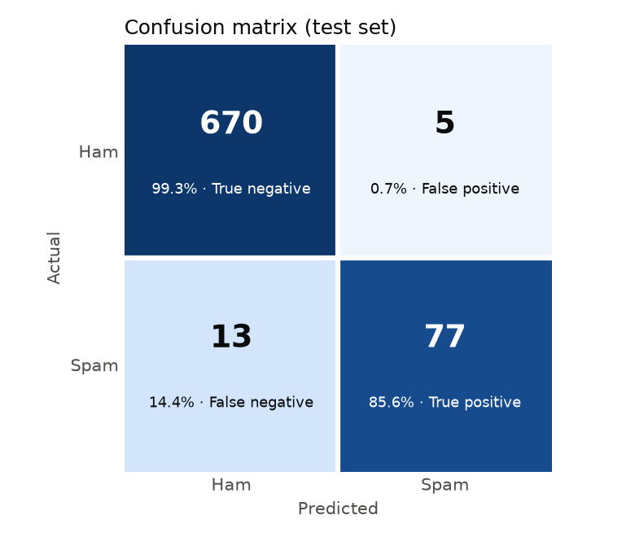

# SmartSpam — SMS Spam Detection System

[](https://github.com/kimasetm/SMS-SPAM-DETECTOR/actions/workflows/tests.yml)


SmartSpam is a machine learning web application that classifies SMS text messages as **SPAM** or **HAM**
(legitimate). A PyTorch neural network, trained on the UCI SMS Spam Collection, powers a Streamlit app with a
message scanner, a rule-based **Link Safety Check** for phishing links, CSV batch classification and a model
evaluation dashboard.

> ⚠️ SmartSpam is a text classification project for learning purposes. It is **not** protection against
> phishing, scams or malware. See [Limitations](#limitations).

**Live demo:** not deployed yet. See [docs/deployment.md](docs/deployment.md) to deploy it on Streamlit Community Cloud.

## Screenshots

| Message scanner | Batch CSV with accuracy check |
|---|---|
|  |  |

<details>
<summary><b>Model evaluation dashboard</b></summary>


</details>

## Features

- **Message scanner:** paste a message and get SPAM or HAM with a confidence score, a spam-probability bar,
  example messages, an empty-input warning, and a view of the cleaned text the model actually reads.
- **Link Safety Check:** flags phishing warning signs in any links (raw IP addresses, the `@` trick, punycode
  look-alikes, brand names on unofficial domains, link shorteners, abused domain endings, phishing words, plain
  `http`), without ever opening them. It warns when the AI rates the text as legitimate but the link is risky.
- **Batch CSV classification:** upload up to 5,000 messages, review the results and download the predictions.
  If the file includes a `label` column, the app also reports accuracy, precision, recall and F1 on your file.
- **Model evaluation dashboard:** real test-set metrics with the change from v1.0, the confusion matrix, training
  charts and the class-imbalance experiment.
- **Trained neural network:** every SPAM/HAM prediction comes from the model; there are no keyword rules. (The
  Link Safety Check is a separate, clearly labelled rule-based layer.)
- **Validation-tuned decision threshold:** chosen by a controlled experiment to catch more spam.
- **Reproducible pipeline:** fixed random seeds, so retraining produces identical weights.
- **Input validation and safe export:** clear errors for empty, overly long or unreadable input; exported CSVs are
  protected against spreadsheet **formula injection**.
- **127 automated tests**, run by **GitHub Actions** on every pull request (Python 3.12 and 3.14).

## Technologies

| Area | Tools |
|---|---|
| Language | Python |
| Neural network | PyTorch |
| Data processing | pandas, NumPy |
| Evaluation | scikit-learn |
| Charts | Matplotlib |
| Web app | Streamlit |
| Testing and CI | pytest, Streamlit AppTest, GitHub Actions |
| Version control | Git, GitHub (feature branches and pull requests) |

## Machine learning architecture

```
SMS text
  → clean_text()                 lowercase, decode HTML, replace URLs / phone numbers / prices / numbers
                                 with placeholder words, remove punctuation
  → TextVectorizer               words → integer IDs (vocabulary built from training data only),
                                 padded or truncated to 50 words
  → Embedding (6,314 × 32)       a learned 32-number vector for each word
  → Global average pooling       averages the word vectors (ignoring padding) → one vector per message
  → Dropout (0.3)
  → Dense (16, ReLU)
  → Dropout (0.3)
  → Dense (1) → sigmoid          probability that the message is spam (≥ 0.30 → SPAM; threshold tuned on validation)
```

- 202,593 trainable parameters.
- Training: binary cross-entropy loss, Adam optimizer (learning rate 0.001), batch size 32.
- **Early stopping:** stops when validation loss hasn't improved for 3 epochs and keeps the best weights.
  The current model stopped after epoch 18; the best epoch was 15.
- The same `clean_text()` and vocabulary are used for training and prediction, so the model always gets input
  in the format it learned from.

The project brief allowed TensorFlow/Keras or PyTorch. PyTorch was chosen because TensorFlow didn't provide packages
for Python 3.14, the development environment. `TextVectorizer` and masked average pooling are the PyTorch
counterparts of Keras' `TextVectorization` and `GlobalAveragePooling1D`.



## Dataset

[UCI SMS Spam Collection](https://archive.ics.uci.edu/dataset/228/sms+spam+collection) by Almeida, Gómez Hidalgo
and Yamakami (2011): 5,574 English SMS messages labelled ham or spam.

| Step | Result |
|---|---|
| Raw messages | 5,574 (about 13% spam) |
| After removing duplicate and empty messages | 5,096 (478 removed) |
| Training / validation / test split (stratified 70 / 15 / 15) | 3,567 / 764 / 765 |

**Preventing data leakage:** duplicates are removed *before* splitting, so no message appears in both training and
test data; the vocabulary is built from the training set only; and the test set is used once, for final evaluation.
The dataset isn't stored in this repository; `python -m src.download_data` downloads it.

## Evaluation results

Measured on the **held-out test set**: 765 messages (675 ham, 90 spam) that weren't used for training or model selection.

| Metric | v1.0 (threshold 0.50) | **v2 (threshold 0.30)** |
|---|---|---|
| Accuracy | 97.65% | **97.65%** |
| Precision (spam) | 95.00% | **93.90%** |
| Recall (spam) | 84.44% (76 of 90 caught) | **85.56%** (77 of 90 caught) |
| F1-score (spam) | 0.8941 | **0.8953** |
| False alarms | 4 of 675 | 5 of 675 |
| ROC-AUC | 0.9863 | 0.9863 |



Because only ~12% of messages are spam, accuracy alone is misleading: labelling everything "ham" would score 88%.
That's why precision, recall and F1 are reported. Full results are in [`reports/metrics.json`](reports/metrics.json)
(v1.0: [`reports/metrics_v1.json`](reports/metrics_v1.json)).

### Improving spam recall: experiment

v1.0 missed about 1 in 6 spam messages. To fix this, four ways of handling the class imbalance were compared using
**only the validation set**, with a selection rule fixed before running: highest validation F1
(`python -m src.compare_models`).

| Variant (validation set, 89 spam) | Threshold | Precision | Recall | F1 |
|---|---|---|---|---|
| v1.0 baseline (no weighting) | 0.50 | 97.40% | 84.27% | 0.9036 |
| **No weighting, threshold tuned on validation** ✅ | **0.30** | 94.12% | **89.89%** | **0.9195** |
| Moderate spam weighting (√ ham/spam ratio) | 0.68 | 96.30% | 87.64% | 0.9176 |
| Full spam weighting (ham/spam ratio) | 0.89 | 96.15% | 84.27% | 0.8982 |

**Findings:** weighting spam more heavily during training did *not* beat simply lowering the decision threshold.
On the test set, the gain was smaller than on validation (+1 spam caught rather than +5), at the cost of one extra
false alarm. With only 90 test spam messages, one message is about one percentage point of recall, so the
improvement is modest. The network's weights are unchanged; only the threshold moved.

Note: the test set was first used to evaluate v1.0. All v2 choices were made on the validation set, and the test set
was used once more only to report the final result.

## Installation

Requires Python 3.10 or newer.

```bash
git clone https://github.com/kimasetm/SMS-SPAM-DETECTOR.git
cd SMS-SPAM-DETECTOR

python -m venv .venv
.venv\Scripts\activate          # Windows
source .venv/bin/activate       # macOS / Linux

pip install -r requirements.txt
```

The trained model is included in `models/`, so you can run the app right away.

## Usage

### Run the web app

```bash
streamlit run app.py
```
Then open <http://localhost:8501>.

### Train and evaluate the model

```bash
python -m src.download_data     # download the dataset into data/raw/
python -m src.preprocessing     # clean, de-duplicate and split the data
python -m src.train             # train the network (about 15 seconds on a laptop CPU)
python -m src.evaluate          # test-set metrics and charts → reports/
python -m src.compare_models    # optional: rerun the class-imbalance experiment (validation set)
```

### Predict from the command line

```bash
python -m src.predict "WINNER!! You have been selected to receive a £900 prize reward! Call 09061701461"
# SPAM  (confidence 97.7%, spam probability 0.9774)

python -m src.batch samples/labeled_messages.csv predictions.csv
```

The CSV needs a `message` column (`text`, `sms` or `body` also work). An optional `label` column (spam/ham) enables
accuracy scoring. Limits: 5 MB and 5,000 rows.

### Run the tests

```bash
python -m pytest
```

## Project structure

```
├── app.py                  # Streamlit web app
├── src/
│   ├── config.py           # paths, hyperparameters and settings
│   ├── download_data.py    # downloads the UCI dataset
│   ├── preprocessing.py    # cleaning, label encoding, de-duplication, train/val/test split
│   ├── text_vectorizer.py  # words → integer sequences (fitted on training data only)
│   ├── model.py            # the neural network, save/load, batch inference
│   ├── train.py            # reproducible training, early stopping, threshold tuning
│   ├── compare_models.py   # class-imbalance experiment on the validation set
│   ├── metrics.py          # accuracy, precision, recall, F1, ROC-AUC, threshold selection
│   ├── evaluate.py         # test-set evaluation and charts
│   ├── predict.py          # prediction engine with input validation
│   ├── link_check.py       # rule-based Link Safety Check (never opens links)
│   └── batch.py            # CSV reading, batch classification, label scoring, safe export
├── tests/                  # 127 pytest tests, including Streamlit UI tests
├── models/                 # trained weights, vocabulary, config, training history
├── reports/                # metrics.json and evaluation charts
├── samples/                # example CSV files
├── docs/                   # report, limitations, deployment guide, demo outline, screenshots
├── data/                   # dataset (downloaded, not committed)
├── .github/workflows/      # CI: tests on every pull request
└── .streamlit/config.toml  # app theme and upload limit (no secrets)
```

## Development workflow

The project was developed incrementally with Git branches:

- `main`: stable releases
- `dev`: integration branch where finished features are combined and tested
- Feature branches cut from `dev` and merged back by pull request:
  - v1.0: `feature/data-preprocessing`, `feature/neural-network`, `feature/model-evaluation`,
    `feature/prediction-engine`, `feature/streamlit-ui`, `feature/testing-docs`
  - v2.0: `feature/improve-recall`, `feature/link-safety-check`

GitHub Actions runs the full test suite on every pull request into `dev` or `main`. Releases are tagged (`v1.0`).

## Limitations

v1.0 had four main weaknesses. v2 addressed the first two; the others remain:

| v1.0 limitation | v2 status |
|---|---|
| Missed about 1 in 6 spam messages (recall 84.4%) | **Improved, modestly.** A validation-tuned threshold raised test recall to 85.6% (77 of 90), at the cost of one extra false alarm. Class weighting was tested and didn't help. About 1 in 7 spam messages still gets through. |
| Couldn't judge links: every URL became the same placeholder word | **Partly addressed.** The new Link Safety Check flags phishing warning signs and caught a parcel-delivery scam that the model labelled HAM. It never visits links and doesn't use blocklists, so "no warning signs" doesn't mean safe. |
| Ignores word order; fooled by misspellings like "fr33 pr1ze" | Remains (average pooling) |
| Old 2011 training data; English only; uncalibrated confidence | Remains |

Full details, with measured examples: **[docs/limitations.md](docs/limitations.md)**.

## Future improvements

- Train on newer and more diverse data, including modern phishing (smishing) messages and other languages.
- Try sequence-aware models (LSTM, 1D CNN or a small pre-trained transformer) that understand word order.
- Add character-level features to resist misspellings.
- Check links against threat-intelligence blocklists and domain-age data, and add sender checks.
- Calibrate confidence scores (e.g. temperature scaling) and monitor the model over time.
- Deploy publicly on Streamlit Community Cloud.

## Documentation

- [Project report](docs/report.md): what was built, technology choices, problems solved, lessons learned
- [Limitations](docs/limitations.md): what the model can't do, with measured examples
- [Deployment guide](docs/deployment.md): Streamlit Community Cloud
- [Demo outline](docs/presentation.md): five-minute presentation script and recording checklist

## Acknowledgments

Dataset: T. A. Almeida, J. M. Gómez Hidalgo and A. Yamakami, "Contributions to the Study of SMS Spam Filtering:
New Collection and Results," *Proceedings of the 2011 ACM Symposium on Document Engineering (DocEng '11)*.
Available from the [UCI Machine Learning Repository](https://archive.ics.uci.edu/dataset/228/sms+spam+collection).
